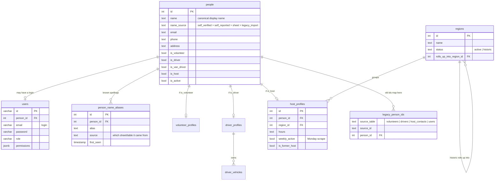
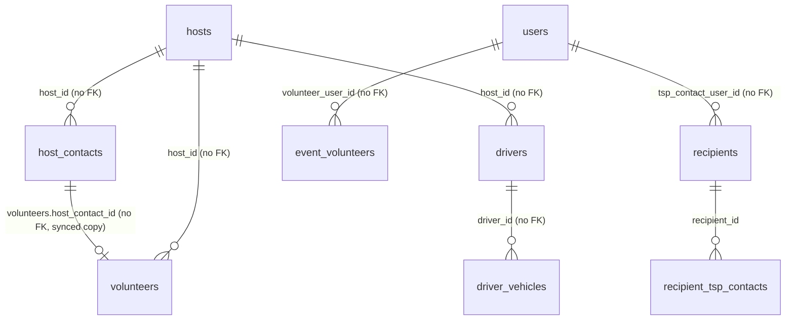

# Data Model

How the tables in `shared/schema.ts` relate to each other, and the rules that
keep them consistent. **This file is part of the schema.** A PR that adds or
changes a table updates this file in the same PR.

- The rules every schema change must follow are in **CLAUDE.md → "Schema rules"**.
- `npx tsx scripts/check-schema-integrity.ts` (`npm run check:schema`) enforces
  the mechanical parts. It fails on any table not named here in backticks.
- Legacy tables that predate these rules are listed in
  `scripts/schema-integrity-baseline.json`. That list only shrinks.

Sections:

1. [People & places: target design](#1-people--places-target-design-planned) *(planned, not built yet)*
2. [People & places: current tables](#2-people--places-current-tables-legacy) *(what exists today)*
3. [Conventions](#3-conventions)
4. [Open decisions](#4-open-decisions)

---

## 1. People & places: target design (PLANNED)

> **Status: agreed design, not built.** Nothing in this section exists in the
> database yet. It's built in phases (see "Build order" below), and each phase
> moves its tables from here into the live documentation.

### Why

Today one human can be stored in up to five tables (`users`, `volunteers`,
`drivers`, `host_contacts`, `contacts`). Each copy has its own phone, address
and van approval, and they drift apart. `server/services/host-contact-volunteer-sync.ts`
exists only to copy hosts into `volunteers`. The design below stores each
human once and gives them roles.

### Diagram

### Tables

| Table | One row per | Notes |
|---|---|---|
| `people` | human TSP knows | Identity + role flags. Replaces the person data in `volunteers`, `drivers`, `host_contacts`, `contacts`, and the non-login parts of `users`. |
| `users` (slimmed) | login account | Login only: email, password, role, permissions, `person_id`. Van approval, address, phone and willingness fields move off `users`. |
| `person_name_aliases` | spelling of a person's name | Every spelling seen in any sheet or legacy table. Used for matching and for the name-verification worklist. |
| `volunteer_profiles` | person with `is_volunteer` | Experience level, training completed, sheet-sync bookkeeping. |
| `driver_profiles` | person with `is_driver` | Availability, cooler status, agreement signed, weekly driver. `driver_vehicles` hangs off this. Which legacy `drivers` columns carry over is decided by the data audit. |
| `host_profiles` | person with `is_host` | Region, hours, weekly-active, former host. **Hosts are people**; their address lives on `people`. |
| `regions` | collection grouping | What the legacy `hosts` table actually holds. Historic sub-regions stay as `historic` rows pointing at the current region they roll up into. |
| `legacy_person_ids` | old row id | Maps old ids (`volunteers` 12, `drivers` 5, `host_contacts` 3, ...) to the new person. Keeps the `"volunteer-12"` style strings in `event_requests.assigned_*_ids` resolving. |
| `recipients` | recipient organization | **Stays separate** from `people`. Recipients never volunteer, drive or host, and carry very different data. |

### Rules

1. **The flag is the switch; the profile row is just details.**
   - Turning a role on sets the flag. An empty or missing profile is allowed.
   - Turning a role off sets the flag false and **keeps** the profile row.
     Re-enabling restores everything.
   - Never delete a profile row to remove someone from a role.
2. **People are deactivated, never deleted.** Foreign keys to `people` use
   `onDelete: 'restrict'`. Past events, collections and assignments must
   always resolve to a person.
3. **Names only get upgraded, never downgraded.** `people.name_source` ranks
   where the name came from:
   1. `self_verified`: the person confirmed it directly
   2. `self_reported`: they typed it themselves. Every legacy driver with
      `surveySubmitted = true` qualifies: the name was entered by hand from
      their survey response.
   3. `sheet`: from a coordinator's Google Sheet
   4. `legacy_import`: from an old table

   A lower-ranked source never overwrites a higher-ranked name. The new
   spelling is stored in `person_name_aliases` instead of being thrown away.
4. **Matching order** (sheet sync and the legacy backfill):

   | Situation | Result |
   |---|---|
   | Exact full name (case/whitespace-insensitive) or a known alias | auto-match |
   | Same last name; first name is a known nickname (Laurie/Laura, Bill/William) or 1–2 letters off (Jon/John) | auto-match **only if** it is the sole candidate with that last name and email/phone don't contradict |
   | Same as above with more than one candidate (family members) | flag for review |
   | First name matches, last name slightly off (Myler/Mylar) | flag for review |
   | Email or phone matches, name doesn't | auto-match, record the alias |
   | Nothing matches | "possible new person" in the sync report |

   Once a sheet row is matched, the app writes the person id back into a hidden
   sheet column so later syncs match exactly.
5. **Full names are visible** to everyone with app access. The
   first-name/last-initial convention belongs to the separate host-finder app
   and will be handled if and when that app is connected.
6. **Historic region names are never rewritten.** `sandwich_collections.host_name`
   keeps the name recorded at the time; reporting rolls historic regions up via
   `regions.rolls_up_into_region_id`. (Today `server/bulk-map-hosts.ts` and the
   host-rename path in `server/database-storage.ts` rewrite old collection rows.
   That behaviour goes away.)
7. **Google Sheet sync**: someone missing from the sheet is marked "not on
   sheet," never deleted. Every sync writes a report (added / updated /
   flagged / possible new).

### Sheet sources

| Sheet | Sets | Status |
|---|---|---|
| Volunteer sheet | `is_volunteer` + `volunteer_profiles` | ready to build after `people` exists |
| Recipient sheet | `recipients` | independent of `people`; can be built any time |
| Driver roster (driver coordinator's sheet) | `is_driver` / weekly driver | **blocked**: sheet needs cleanup to one row per person first |

### Build order

Each step is its own PR.

0. Schema rules, the integrity check, and this document. ✅
1. Recipients directory: plain list as the default view; the detailed views move to a secondary tab.
2. Data audit (read-only): duplicates across the five people tables, conflicting phones/emails, abbreviated "First L." names, survey-driver names edited after entry, distinct region names in `sandwich_collections`.
3. `regions` table + historic roll-up mapping.
4. `people`, `person_name_aliases`, `legacy_person_ids` (additive only).
5. Backfill script with `--dry-run`. **A script, not a migration**: migrations run automatically on every boot, including production. Tested against a Neon branch of production.
6. Volunteer directory reads from `people`; volunteer sheet sync.
7. Host directory reads from `people` + `host_profiles`.
8. Recipient sheet sync.
9. Driver roster sync (after the driver coordinator's sheet is cleaned up).
10. Retire the legacy people tables: read-only first, removed later.

---

## 2. People & places: current tables (LEGACY)

What exists today. Everything here is slated for replacement by section 1
except `recipients`, `recipient_tsp_contacts` and `driver_vehicles`.

| Table | What it really holds | Known problems |
|---|---|---|
| `users` | Login accounts, **plus** van approval, address, phone and event-role willingness/approval | Mixes "can log in" with "who is this person." |
| `volunteers` | Volunteers | ~20 columns copied from `drivers`. Rows linked to host contacts are machine-maintained copies. |
| `drivers` | Drivers | ~45 columns, many of uncertain use (decided by the data audit). |
| `driver_vehicles` | A driver's vehicles | `driver_id` has no FK. |
| `driver_agreements` | Driver agreement submissions | Keyed by email, not by person. |
| `hosts` | **Regions** (e.g. "Alpharetta"), despite the name | The misnaming is why `host_contacts` exists. |
| `host_contacts` | **The actual hosts** (people) | `host_id` has no FK. Its own van approval and driver-agreement flags. |
| `contacts` | Generic catch-all contact list | Overlaps all of the above. |
| `recipients` | Recipient organizations | Fine as a separate table. |
| `recipient_tsp_contacts` | TSP people assigned to a recipient | |
| `event_volunteers` | Volunteer Hub signups | Points at `users`, so only people with logins can be linked. |
| `event_requests` | Event requests | `assigned_driver_ids` / `assigned_volunteer_ids` / `assigned_speaker_ids` are text arrays of strings like `"volunteer-12"`, `"driver-5"`, `"host-contact-3"`, `"user-abc"`. These can't be FKs; `legacy_person_ids` keeps them resolvable. |
| `sandwich_collections` | Collections log (source of truth for counts) | Region stored as text in `host_name`, not an id. |
| `sandwich_distributions` | Sandwiches delivered to recipients | `host_id`, `recipient_id` have no FK. |

Van approval is currently stored in four places: `users.van_approved`,
`drivers.van_approved`, `volunteers.van_approved`, `host_contacts.van_approved`.
In the target design it is one flag: `people.is_van_driver`.

---

## 3. Conventions

- **Link columns end in `_id`** and are real foreign keys with a `relations()` entry.
- **An `_id` column that isn't a link** (an external system's id, or a
  polymorphic id paired with a `type`/`table_name` column) is listed in
  `scripts/schema-integrity-exceptions.json` with the reason. Prefer a clearer
  name for new ones (`google_sheet_row_id`, `stream_user_id`).
- **Text arrays of ids** (`event_requests.assigned_*_ids`) are legacy. Don't add
  new ones; use a join table with real FKs instead.

---

## 4. Open decisions

- **Sheet vs app on conflicts:** when the volunteer sheet and the app disagree on
  phone/email, which wins? (Leaning: the sheet owns the columns it has, and the app
  labels those fields "managed by Google Sheet.")
- **Historic regions:** which current region each historic sub-region rolls
  up into. Known by someone, or derived from collection records?
- **Driver roster:** what the driver coordinator's sheet becomes once cleaned up, and whether
  all of her drivers also count as volunteers.
- **`driver_profiles` columns:** which of the ~45 legacy `drivers` columns are
  actually used. Decided by the data audit.
