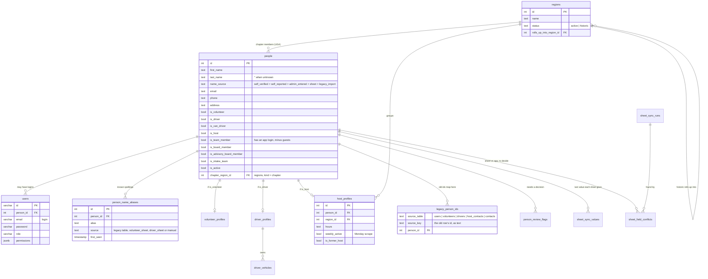
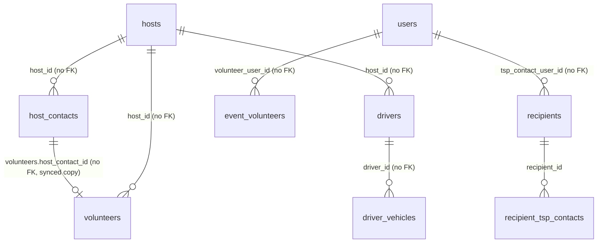
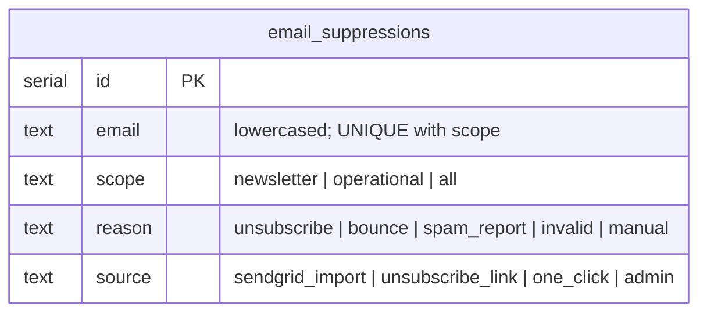
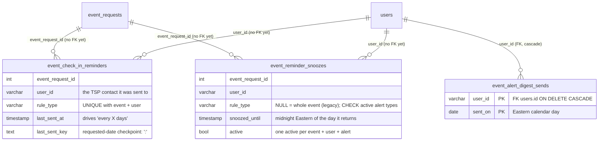

# Data Model

How the tables in `shared/schema.ts` relate to each other, and the rules that
keep them consistent. **This file is part of the schema.** A PR that adds or
changes a table updates this file in the same PR.

- The rules every schema change must follow are in **CLAUDE.md → "Schema rules"**.
- `npx tsx scripts/check-schema-integrity.ts` (`npm run check:schema`) enforces
  the mechanical parts. It fails on any table not named here in backticks.
- Legacy tables that predate these rules are listed in
  `scripts/schema-integrity-baseline.json`. That list only shrinks.

Sections:

1. [People & places: target design](#1-people--places-target-design-planned) *(planned, not built yet)*
2. [People & places: current tables](#2-people--places-current-tables-legacy) *(what exists today)*
3. [Conventions](#3-conventions)
4. [Open decisions](#4-open-decisions)
5. [Email](#5-email)

---

## 1. People & places: target design (PLANNED)

> **Status: agreed design, not built.** Nothing in this section exists in the
> database yet. It's built in phases (see "Build order" below), and each phase
> moves its tables from here into the live documentation.

### Why

Today one human can be stored in up to five tables (`users`, `volunteers`,
`drivers`, `host_contacts`, `contacts`). Each copy has its own phone, address
and van approval, and they drift apart. `server/services/host-contact-volunteer-sync.ts`
exists only to copy hosts into `volunteers`. The design below stores each
human once and gives them roles.

### Diagram

### Tables

| Table | One row per | Notes |
|---|---|---|
| `people` | human TSP knows | Identity + role flags. Replaces the person data in `volunteers`, `drivers`, `host_contacts`, `contacts`, and the non-login parts of `users`. First and last name are stored separately (matching compares last names and first-name nicknames); the display name is the two joined. `email` is not unique: couples share one. `chapter_region_id` links chapter members (UGA students) to their chapter. **Built (step 4); empty until the step 5 backfill.** |
| `users` (slimmed) | login account | Login only: email, password, role, permissions, `person_id`. Van approval, address, phone and willingness fields move off `users`. `person_id` exists (step 4) and is null until the backfill; several logins may point at one person (some staff have two). |
| `person_name_aliases` | spelling of a person's name | Every spelling seen in any sheet or legacy table. Used for matching and for the name-verification worklist. |
| `volunteer_profiles` | person who is or was a volunteer | **Built (step 7).** From the volunteer sheet (read-only in the app): `availability_status` (`active`, `temporarily_unavailable` = away but coming back, `inactive`), `on_recruitment_list` (sheet "Event Volunteer Email List"; false = never on recruitment emails but can be asked one-to-one), `location` (free text), `sheet_notes`, `on_sheet`, `last_seen_on_sheet_at`. App-owned: `experience_level`, `training_completed`. **Recruitment emails go to people who are on the list and `active`.** |
| `sheet_sync_runs` | one run of a sheet sync | Which sheet, scheduled or manual (and by whom), status, and the report (`summary`: added / updated / flagged / missing). |
| `sheet_sync_values` | shared field of a person, per sheet | The value the sheet last gave for `name`, `email` or `phone`: the "last synced value" in rule 8. |
| `sheet_field_conflicts` | field where the sheet and app disagree | Rule 8's review list: a real conflict, a malformed sheet value, or a possible one-digit phone typo. Resolved by choosing the sheet's value or keeping the app's. |
| `driver_profiles` | person with `is_driver` | Availability, cooler status, agreement signed, weekly driver. `driver_vehicles` hangs off this. Which legacy `drivers` columns carry over is decided by the data audit. |
| `host_profiles` | person with `is_host` | Region, hours, weekly-active, former host. **Hosts are people**; their address lives on `people`. |
| `regions` | place collections are logged under | What the legacy `hosts` table actually holds. Has a `kind`: `region` (an area hosts belong to, e.g. Alpharetta), `site` (a partner that collects on its own, e.g. Collective Learning) or `chapter` (e.g. UGA). Historic names stay as `historic` rows, optionally pointing at the current region they roll up into. The agreed list is in "Collection sites and regions" below. |
| `person_review_flags` | open question about a person | Things the backfill (or a later sheet sync) couldn't settle: contact conflict, shared contact, one record naming two people, abbreviated name, possible duplicate, no longer on a sheet (`not_on_sheet`), added from a sheet row that matched nobody (`new_from_sheet`). `resolved_at` / `resolved_by_user_id` / `resolution` record the decision. The "needs a decision" list on the People admin page. |
| `legacy_person_ids` | old row id | Maps old ids (`volunteers` 12, `drivers` 5, `host_contacts` 3, ...) to the new person: `source_table` + `source_key` (text, since `users` ids are strings), unique together. Keeps the `"volunteer-12"` style strings in `event_requests.assigned_*_ids` resolving. |
| `recipients` | recipient organization | **Stays separate** from `people`. Recipients never volunteer, drive or host, and carry very different data. |

### Rules

1. **The flag is the switch; the profile row is just details.**
   - Turning a role on sets the flag. An empty or missing profile is allowed.
   - Turning a role off sets the flag false and **keeps** the profile row.
     Re-enabling restores everything.
   - Never delete a profile row to remove someone from a role.
2. **People are deactivated, never deleted.** Foreign keys to `people` use
   `onDelete: 'restrict'`. Past events, collections and assignments must
   always resolve to a person.
3. **Names only get upgraded, never downgraded.** `people.name_source` ranks
   where the name came from:
   1. `self_verified`: the person confirmed it directly
   2. `self_reported`: they typed it themselves. Every legacy driver with
      `surveySubmitted = true` qualifies: the name was entered by hand from
      their survey response.
   3. `admin_entered`: typed or corrected by an admin on the People page
      (without ticking "this person confirmed this spelling")
   4. `sheet`: from a coordinator's Google Sheet
   5. `legacy_import`: from an old table

   A lower-ranked source never overwrites a higher-ranked name. The new
   spelling is stored in `person_name_aliases` instead of being thrown away.
4. **Matching order** (sheet sync and the legacy backfill):

   | Situation | Result |
   |---|---|
   | Exact full name (case/whitespace-insensitive) or a known alias | auto-match |
   | Same last name; first name is a known nickname (Laurie/Laura, Bill/William) or 1–2 letters off (Jon/John) | auto-match **only if** it is the sole candidate with that last name and email/phone don't contradict |
   | Same as above with more than one candidate (family members) | flag for review |
   | First name matches, last name slightly off (Myler/Mylar) | flag for review |
   | Email or phone matches, name doesn't | auto-match, record the alias |
   | Nothing matches | "possible new person" in the sync report |

   The app only reads sheets (Viewer access), so it doesn't write an id back.
   A matched row is recognized next time by the email or name it last synced
   (`sheet_sync_values`), then by the rules above.
5. **Full names are visible** to everyone with app access. The
   first-name/last-initial convention belongs to the separate host-finder app
   and will be handled if and when that app is connected.
6. **Historic region names are never rewritten.** `sandwich_collections.host_name`
   keeps the name recorded at the time; reporting rolls historic regions up via
   `regions.rolls_up_into_region_id`. (Today `server/bulk-map-hosts.ts` and the
   host-rename path in `server/database-storage.ts` rewrite old collection rows.
   That behaviour goes away.)

   The only roll-up logic in the app today is a naming convention: a combined
   region is named with a slash (e.g. "Dunwoody/PTC"), and the "Include
   Historical Data" toggle in `client/src/components/host-analytics.tsx` also
   counts collections logged under each part ("Dunwoody", "PTC"). Historic
   names that don't follow that pattern aren't connected to anything. The
   mapping is built in step 2: the audit lists every distinct
   `sandwich_collections.host_name` with its record count and first/last date,
   proposes a mapping for the slash-named ones, and leaves the rest for a person
   to assign. (`server/bulk-map-hosts.ts` holds a `"Group 1"` → `"West Metro"`
   style mapping that doesn't match known region names; the audit checks
   whether any of those names exist in the data.)
7. **Google Sheet sync**: someone missing from the sheet is marked "not on
   sheet," never deleted. Every sync writes a report (added / updated /
   flagged / possible new).
8. **Sheet vs app conflicts: the sheet wins by default, but app edits are
   allowed and never silently lost.** For each field the sheet owns, the sync
   stores the value it last read from the sheet (`last_synced_value`). On each
   sync it compares three values: the sheet now, the app now, and the last
   synced value.

   | Sheet since last sync | App since last sync | Result |
   |---|---|---|
   | unchanged | unchanged | nothing to do |
   | changed | unchanged | sheet value applied |
   | unchanged | edited in the app | app edit kept; the sheet is not touched |
   | changed | edited in the app, and they differ | **conflict**: goes to a review list where someone picks which value wins |
   | sheet value is malformed (phone not 10 digits once formatting is stripped, email without `@`/domain) | any | sheet value **not** applied; flagged "sheet value looks wrong" |
   | sheet and app phone differ by a single digit | any | flagged "possible typo" for review, never auto-applied |

   Phone numbers are compared after stripping formatting, so `(404) 555-1234`
   and `404.555.1234` are the same number and never count as a change.

   **First sync** (no last synced value yet): blank app fields are filled from
   the sheet; fields where the app and sheet already disagree go to the review
   list, with an "accept the sheet for all of these" option for the bulk case.

   Writing app edits back into the sheet is out of scope for now. The review list
   and the sync report show app edits the sheet doesn't have, so a coordinator
   can update the sheet by hand.

### Collection sites and regions (agreed 2026-11-19)

Decided with the director from the step 2 audit of production. Every name that
appears in `sandwich_collections.host_name` gets a `regions` row; old
collection rows keep their original text.

**Active**

| Name | `kind` | Notes |
|---|---|---|
| Alpharetta | `region` | |
| Dunwoody/PTC | `region` | PTC = Peachtree Corners |
| East Cobb/Roswell | `region` | |
| Sandy Springs/Chastain | `region` | |
| Intown/Druid Hills/Oak Grove/Chamblee/Brookhaven/Buckhead | `region` | |
| Flowery Branch | `region` | Active; collection numbers are often late |
| Collective Learning | `site` | Treated like any other collection site. Auto-logs a standing weekly count (see Cron Jobs in CLAUDE.md) |
| UGA | `chapter` | TSP chapter in Athens; also a collection site. Some app users are UGA students and need a person-to-chapter link (designed with `people`, step 4) |
| Unassigned | `region` | Placeholder for hosts not yet given a region |

**Historic, rolled up into a current region** (reports showing a region's full
history include these)

| Old name | Rolls up into |
|---|---|
| Sandy Springs | Sandy Springs/Chastain |
| Buckhead, Oak Grove, Decatur, Glenwood Park | Intown/Druid Hills/Oak Grove/Chamblee/Brookhaven/Buckhead |
| Peachtree Corners | Dunwoody/PTC |

**Historic, retired** (no current home; kept under their own name): Dacula
(closed), Snellville, Woodstock (never opened), Intown/Druid Hills,
Lenox/Brookhaven, New Chastain, Chamblee/N Brookhaven, Lilburn, Roswell,
College Park, Suwanee/JC/Duluth.

**OG Sandwich Project**: historic, kept on its own. It's how collections were
recorded before locations were tracked (2020–21).

**Groups are not a region or site.** Group drop-offs are their own kind of
record. One may be linked to the host/region it came through, or to nothing;
both are valid, and the group's own data is what matters. Today they're logged
with `host_name = 'Groups'` or under a region's `group_collections`; the
`regions` work must not turn "Groups" into a region.

### Roles (agreed 2026-11-19)

| Flag | Set by the backfill from | Notes |
|---|---|---|
| `is_driver` | an active `drivers` row | Later owned by the driver roster sync |
| `is_host` | a `host_contacts` row not marked former host | |
| `is_volunteer` | an active `volunteers` row (not a host's machine copy), or a host marked "Also a volunteer" | Low until the volunteer sheet sync (step 7); the sheet is the real list |
| `is_van_driver` | `van_approved` true in any record | |
| `is_team_member` | an active app login | Everyone with a login is on the team, apart from the odd guest (switched off by hand). Informational only |
| `is_board_member` | nothing (added 2026-11-20) | Ticked by hand on the People page. Informational only |
| `is_advisory_board_member` | nothing (added 2026-11-20) | Ticked by hand. Informational only |
| `is_intake_team` | nothing (added 2026-11-20) | Event intake team. Ticked by hand. Informational only: app access still comes from the login's permissions |

Speaker is a retired role and isn't modeled. Committees aren't modeled.

### Sheet sources

| Sheet | Sets | Status |
|---|---|---|
| Volunteer sheet ("All Volunteers" tab; columns Name, Email, Phone, Status, Event Volunteer Email List, Source, Location, Notes) | `is_volunteer` + `volunteer_profiles`; name/email/phone on `people` by rule 8 | **step 7**, agreed 2026-11-20: read daily plus a "Sync now" button; Status must be Active, Temporarily unavailable or Inactive (anything else is flagged, not guessed); `is_volunteer` is on unless Status is Inactive; rows missing from the sheet are flagged `not_on_sheet`, never changed; unmatched rows become new people flagged `new_from_sheet`; the Source column is ignored |
| Recipient sheet | `recipients` | independent of `people`; can be built any time |
| Driver roster (driver coordinator's sheet) | `is_driver` / weekly driver | **blocked**: sheet needs cleanup to one row per person first |

### Build order

Each step is its own PR.

0. Schema rules, the integrity check, and this document. ✅
1. Recipients directory: plain list as the default view; the detailed views move to a secondary tab. ✅
2. ✅ Data audit (read-only, `npm run audit:people`): duplicates across the five people tables, conflicting phones/emails, abbreviated "First L." names, survey-driver names edited after entry, distinct region names in `sandwich_collections` (with counts and date ranges, plus a proposed historic roll-up), and a **column-usage report for `drivers`** (per column: how many rows have a value, and how recently one was set) so the `driver_profiles` columns are chosen from real data.
3. `regions` table + historic roll-up mapping. The table is created by `migrations/20261120_create_regions.sql`; its rows come from `npm run regions:seed -- --dry-run` / `--apply` (`scripts/seed-regions.ts`, which holds the agreed list below and reports any collection-log name still without a row). Nothing in the app reads `regions` yet.
4. `people`, `person_name_aliases`, `legacy_person_ids`, `users.person_id` (additive only): `migrations/20261121_create_people.sql`. Empty until step 5.
5. Backfill script with `--dry-run` (`npm run people:backfill -- --dry-run` / `--apply`, `scripts/backfill-people.ts`). One-shot; applies the matching rules above and the roles listed under "Roles" below; writes `person_review_flags` for anything it can't settle. **A script, not a migration**: migrations run automatically on every boot, including production. Tested against a Neon branch of production.
6. ✅ **People admin page** (super admin and admin): everyone in `people` with search and filters, a checkbox per role, the active switch, each person's full record (contact, other spellings, old records, chapter), and the "needs a decision" list from `person_review_flags` with buttons to resolve them.
7. Volunteer sheet sync and volunteer directory. **7a (sync) built:** `npm run volunteers:sync -- --dry-run` / `--apply`, a daily job (after the first hand-run sync), and `/api/people-admin/volunteer-sync` for the People page's "Sync now". 7b: People page shows volunteer details, "Sync now" and the sheet-vs-app questions. 7c-1 (built): the Volunteers Directory page reads `people` + `volunteer_profiles` (read-only, `/api/volunteer-directory`), with the old list one click away. 7c-2: event assignment picks from `people`. 7c-3: driver planning, route map and host-volunteer copies move over; the old list retires.
8. Host directory reads from `people` + `host_profiles`.
9. Recipient sheet sync.
10. Driver roster sync (after the driver coordinator's sheet is cleaned up).
11. Retire the legacy people tables: read-only first, removed later.
12. Move the database off Replit's built-in database to our own Neon account. Replit bills by how long the database is active (about $60/month); Neon directly should cost much less. It also ends the publish screen's schema syncing (see below), because dev and production become two Neon branches that our migrations keep in step. To plan: copy production into the new Neon project and check row counts table by table; point `DATABASE_URL` (production) and `DEV_DATABASE_URL` (a Neon dev branch) at it, keeping `server/db-url.ts` the only place that decides; a short write freeze during the switch; keep the old database untouched for a few weeks as a fallback.

**Before every publish (until step 12):** run `npm run db:compare`. Replit's publish screen makes production's structure match the dev database, deleting anything dev lacks. If it says NOT SAFE or NOT READY, run `npm run db:sync-dev -- --apply` first. This removed `person_review_flags` and `people.is_team_member` from production on 2026-11-19, and `recurring_collection_overrides` in October.

---

## 2. People & places: current tables (LEGACY)

What exists today. Everything here is slated for replacement by section 1
except `recipients`, `recipient_tsp_contacts` and `driver_vehicles`.

| Table | What it really holds | Known problems |
|---|---|---|
| `users` | Login accounts, **plus** van approval, address, phone and event-role willingness/approval | Mixes "can log in" with "who is this person." |
| `volunteers` | Volunteers | ~20 columns copied from `drivers`. Rows linked to host contacts are machine-maintained copies. |
| `drivers` | Drivers | ~45 columns, many of uncertain use (decided by the data audit). |
| `driver_vehicles` | A driver's vehicles | `driver_id` has no FK. |
| `driver_agreements` | Driver agreement submissions | Keyed by email, not by person. |
| `hosts` | **Regions** (e.g. "Alpharetta"), despite the name | The misnaming is why `host_contacts` exists. |
| `host_contacts` | **The actual hosts** (people) | `host_id` has no FK. Its own van approval and driver-agreement flags. |
| `contacts` | Generic catch-all contact list | Overlaps all of the above. |
| `recipients` | Recipient organizations | Fine as a separate table. |
| `recipient_tsp_contacts` | TSP people assigned to a recipient | |
| `event_volunteers` | Volunteer Hub signups | Points at `users`, so only people with logins can be linked. |
| `event_requests` | Event requests | `assigned_driver_ids` / `assigned_volunteer_ids` / `assigned_speaker_ids` are text arrays of strings like `"volunteer-12"`, `"driver-5"`, `"host-contact-3"`, `"user-abc"`. These can't be FKs; `legacy_person_ids` keeps them resolvable. |
| `sandwich_collections` | Collections log (source of truth for counts) | Region stored as text in `host_name`, not an id. |
| `sandwich_distributions` | Sandwiches delivered to recipients | `host_id`, `recipient_id` have no FK. |

Van approval is currently stored in four places: `users.van_approved`,
`drivers.van_approved`, `volunteers.van_approved`, `host_contacts.van_approved`.
In the target design it is one flag: `people.is_van_driver`.

---

## 3. Conventions

- **Link columns end in `_id`** and are real foreign keys with a `relations()` entry.
- **An `_id` column that isn't a link** (an external system's id, or a
  polymorphic id paired with a `type`/`table_name` column) is listed in
  `scripts/schema-integrity-exceptions.json` with the reason. Prefer a clearer
  name for new ones (`google_sheet_row_id`, `stream_user_id`).
- **Text arrays of ids** (`event_requests.assigned_*_ids`) are legacy. Don't add
  new ones; use a join table with real FKs instead.

---

## 4. Open decisions

- **Driver roster:** what the driver coordinator's sheet becomes once cleaned up, and whether
  all of her drivers also count as volunteers.
- **`driver_profiles` columns:** which of the ~45 legacy `drivers` columns are
  actually used. Decided from the step 2 column-usage report.

Resolved:

- **Sheet vs app on conflicts:** three-way comparison; see rule 8 in section 1.
- **Historic regions:** decided from the step 2 audit; see "Collection sites
  and regions" in section 1.

---

## 5. Email

| Table | One row is | Notes |
|---|---|---|
| `email_suppressions` | One address the app must not send a kind of email to | Keyed by address, not by person, on purpose: most recipients (event contacts, volunteers without logins) have no `users`/`people` row, so there is no FK. The email helper (`server/services/email/`) checks it before every send. Filled by the public email preferences page, one-click List-Unsubscribe, and the one-off `scripts/import-sendgrid-suppressions.ts`. |

Scopes: `newsletter` blocks newsletter/announcement mail, `operational` blocks
operational mail, `all` blocks everything. The admin monitoring copy is never
suppressed.

---

## 6. Event alerts

The daily digest email TSP contacts get about their events (formerly "check-in
reminders"). Timing rules: `server/services/event-alerts/rules.ts`. Runner:
`server/services/check-in-reminder-service.ts`. Settings live in
`users.metadata.checkInReminderPreferences` (one set per person, all events).

| Table | One row is | Notes |
|---|---|---|
| `event_check_in_reminders` | What was last sent for one alert, on one event, to one person | Written when a digest goes out. Each run first deletes rows that no longer apply (event reassigned or deleted, or moved to a status that alert doesn't cover), so a returned event or a status reversal gets fresh alerts. Rows for an alert the person turns off are deleted when they save, so turning it back on starts fresh. Legacy columns (`enabled`, `threshold_days`, `frequency`, `channel`, `next_due_at`) are no longer read. |
| `event_alert_digest_sends` | One daily digest sent to one person on one Eastern day | The once-a-day limit. A run claims the day by inserting this row before sending (the primary key rejects a second claim) and deletes it if nothing was delivered, so the next hourly run retries. Its own table, not `users.metadata`, because settings saves rewrite that whole blob and could erase a claim mid-send. |
| `event_reminder_snoozes` | One "remind me again in N days" pause | Created from the email's confirm step (`AlertSnoozeFromLink.tsx`). Ends when it expires (the alert returns in that day's digest) or when its problem is fixed. Capped server-side to end by the day before the event, and re-checked daily: if the event's date moves up to tomorrow or today, no snooze silences it. |

`event_requests.last_human_update_at` is what "no updates" measures: stamped by
`markEventHumanUpdated()` (`server/services/event-alerts/human-update.ts`) on
successful writes by a signed-in user (every `/api/event-requests/:id/...`
write, the body-id routes, notification action buttons), never by the Google
Sheet sync or cron jobs (which do bump `updated_at`). New events default to
`now()`. Events that existed before the column are filled once by
`npm run alerts:backfill` (dry run first); until then the alert falls back to
`updated_at`.

Both tables predate the schema rules: their `event_request_id` / `user_id`
links have no foreign keys yet (listed in the baseline). Adding them needs a
cleanup of orphaned rows first, so it's left for its own PR.
